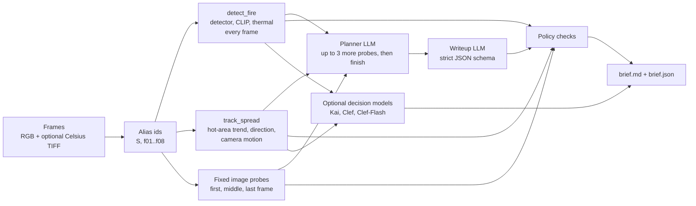

# How the recon gateway builds a brief

The recon gateway (`src/recon_gateway/`) turns a short, time-ordered sequence of drone frames into a structured
reconnaissance brief. The gateway makes every measurement itself, so the evidence never depends on what a model chose
to do. The vision LLM does three jobs: it picks a few extra frames to check, answers yes/no image questions, and
writes the brief. A policy step then checks the writeup against the measurements.

## Steps

1. **Alias ids.** Frames are sorted by capture time and renamed `f01`, `f02`, and so on; the sequence becomes `S`.
   Dataset ids such as `plot1_preburn_0040` or `Fire_121` would tell a model the answer.
2. **`detect_fire`** runs on every frame through the fire classifier:
   - the fine-tuned DINOv2 + LoRA fire probability, thresholded at the lower of 0.5 and the recall-tuned threshold from
     training;
   - a CLIP zero-shot second opinion;
   - when a Celsius TIFF exists, the thermal tools: hottest pixel, share and count of pixels at or above 80 C, hot-area
     center and box, and whether the hot area touches the frame edge.
3. **`track_spread`.** The trend comes from the change in hot area between the first and last third of the thermal
   frames. Direction comes from how far the hot-area center moves after camera motion is removed (phase correlation).
   If the camera moved more than 8% of the frame, or the motion estimate is weak, both are marked unsupported.
4. **Fixed image probes.** On the first, middle and last frame, the LLM answers "Is smoke visible?" and "Are flames
   or glowing fire visible?".
   - Each question has lettered options, and the answer comes from the probability of each letter in the first
     generated token, not from free text.
   - A token counts only if it is the letter itself, ignoring spaces and a trailing `.`, `)` or `:` (so a bare space or
     "Answer" never counts). When less than half the probability falls on the letters, the answer is marked unreliable.
5. **Planner (agent mode).** The LLM sees the measurements and may call `decide` on up to 3 more frames, then
   `finish`.
   - Tool choice is forced, frame ids are an enum of the real ids, and arguments are validated.
   - A bad call gets an error message back instead of a silent fallback.
   - `--mode pipeline` skips the planner for fixed, comparable runs.
6. **Writeup.** The LLM gets the evidence and the first and last frames, and returns JSON that must match
   `brief.BRIEF_SCHEMA` (strict: every field required, no extra fields). It may not quote hot-area numbers; the gateway
   adds the measured value.
7. **Policy checks** (`brief.enforce_policy`):
   - **Fire status.** The measurement rule (`brief.evidence_status`) decides from thermal when thermal exists, else
     from the detector. Without thermal, and with the detector flagging fewer than half the frames, a "yes" to flames
     (probability at least 0.8) on at least 2 of the 3 fixed probe frames raises "fire" at low confidence.
   - **When the rule overrides.** The rule overrides the writeup only on strong measurements: thermal data, or the
     detector flagging at least half the frames. On weak RGB-only evidence it is recorded as a limitation instead.
   - **Confidence.** When the writeup and the rule agree, the writeup's confidence is capped at the rule's.
   - **Unsupported claims.** A direction or trend that tracking does not support becomes "indeterminate". Acres, GPS,
     speeds and crew instructions in the summary and inferences are replaced with "[out of scope]". Overall confidence
     drops from high to medium when fire status or direction is indeterminate (unless there is no fire or smoke).
8. **Decision models (optional, `--deciders kai,clef,clef_flash`; also `d3`, `d3_mini`, `d3_flash`).** Each one answers
   the same fire-status question from the measurements written as sentences. Clef, Clef-Flash and the d3 models also see
   the first and last frames. Their calls are reported next to the brief and never change it.

Every LLM call uses temperature 0 and a fixed seed. The observer guidance (`prompts.WATCH_FOR`, `--guidance`) is
optional and can be turned on separately for the planner, the image probes and the writeup.

## Decision-model cascade (optional)

`recon_gateway.cascade` puts a decision model in front of the LLM. d3 reads all 8 frames, the observer guidance and
the thermal facts only (the RGB detector's counts are left out, because they pulled d3 toward "no fire"). If its top
status probability is at least 0.80 and the answer is not "unclear", that is the call. Otherwise `agent.run` does a
deeper pass with `probe_all=True` (guided image checks on every frame) and d3's probabilities passed in as
`extra_evidence`; failed passes are retried up to 2 times. Results: `experiments/decision-cascade/`.

## Output

- `brief.md`: the brief as a table plus observations, inferences and limitations.
- `brief.json` holds:
  - the final brief and the raw writeup before the policy step;
  - the policy corrections;
  - all evidence, including raw top log-probs for every probe;
  - the planner's turns (finish reason, tool calls, token use);
  - a timed step trace and any decision-model calls.

The brief is decision support only. A person makes every call.
